<h1 align="center">irwkv</h1>

<div align="center">

<p><strong>High-Throughput CUDA Inference &amp; Serving Engine for RWKV-7 — Continuous Batching, Recurrent State Management &amp; RL-Ready Serving</strong></p>

[](LICENSE)
[](pyproject.toml)
[](requirements/rwkv.txt)
[](requirements/rwkv.txt)
[](docs/models/rwkv.md)

English | [简体中文](README_CN.md)

</div>

---

**irwkv** is an RWKV-7 inference and serving engine derived from [vLLM](https://github.com/vllm-project/vllm) and backed exclusively by the fused CUDA/TileLang operators in [FlashRWKV2](https://github.com/rwkv-rs/FlashRWKV2). It combines vLLM's continuous batching, chunked prefill, asynchronous scheduling/detokenization, and OpenAI-compatible serving stack with $O(1)$ recurrent-state memory management tailored to RWKV-7.

All RWKV-7 model operators stay in FlashRWKV2 and canonical checkpoints come from [transformers-rwkv](https://github.com/rwkv-rs/transformers-rwkv), keeping `irwkv` focused on high-throughput scheduling, CUDA Graph execution, multi-GPU deployment, PEFT serving, and online RL integration.

---

## Why irwkv?

Serving RWKV-7 at scale requires continuous batching, recurrent state pools, OpenAI-compatible APIs, and exact numerical alignment for evaluation and RL rollouts. Here is how `irwkv` fits in the ecosystem:

| Capability | **irwkv (Ours)** | **rwkv_lightning_cuda** | **Albatross** | **transformers-rwkv** | **Standard vLLM (Transformer)** |
| --- | --- | --- | --- | --- | --- |
| **Per-Sequence Memory** | **$O(1)$ fixed recurrent state** (no KV cache growth) | $O(1)$ recurrent state (legacy `.pth` / custom `.rwkvq` only) | $O(1)$ fixed recurrent state | $O(1)$ recurrent state | $O(L)$ KV cache grows with context length |
| **Batching & Prefill** | **Continuous batching** + chunked prefill + async scheduling | Basic C++ chunked loop (fixed `--decode-batch-size` cap, historically prone to admission stalls) | Fixed-batch inference | Static batching | Continuous batching + chunked prefill |
| **State Precision & Parity** | **FP16 state** (default, with DeltaLog budgeting) & **FP32 state** (exact training-recurrence parity) | **FP16 / quantized inference only** — no BF16/FP32 train–infer parity (diverges from BF16 training backbone) | FP16 state only (differs from FP32 training) | FP32 / BF16 reference | KV cache (BF16 / FP8) |
| **CUDA Graph & Structured Outputs** | **Full CUDA Graph** + split-graph **6-param Rapid-Sampling** + `min_p` (keeps graphs for `xgrammar`/`llguidance`/`outlines`) | **No structured output / grammar engine**, no full-graph split Rapid-Sampling, no canonical 3-profile decoding | Fixed-batch CUDA kernels; no grammar engine | Eager / `torch.compile` | Full / piecewise CUDA Graph + structured outputs |
| **Prefix Caching & Multi-Turn** | **Block-aligned COW**, sub-block `--prefix-match-unit`, latest-checkpoint state continuation | Custom L1/L2/SQLite session cache (non-standard, tied to manual session IDs) | No | Manual state passing | PagedAttention block prefix cache |
| **PEFT & External RL Sync** | **Standard HF PEFT LoRA / NoRA** (versioned, multi-tenant) + **`nccl` / `ipc` online weight sync** for Python RL trainers | **Incompatible with HF PEFT LoRA** (custom MiSS / fixed `alpha/rank=1` NoRA only); siloed C++ binaries cannot sync with external RL frameworks | No | PEFT training / inference | LoRA + online weight sync |
| **Multi-GPU Scaling** | Native **PP2** (13.3B on 2× 24 GB) + **DP** + **DP + PP2** | **No native PP2** for large models; requires external Go reverse-proxy router | Single GPU | Single GPU / FSDP | TP / PP / DP / EP |
| **API, Ecosystem & Deployment** | Canonical **`transformers-rwkv` safetensors**, OpenAI **Completions / Chat / Responses**, native `--reasoning-parser` & `--tool-call-parser`, optional **Rust frontend (`irwkv-rs`) + gRPC**, simple `uv` install | Legacy `.pth` + `rwkv_vocab` txt, **no Responses API**, **no native reasoning/tool-call parser ecosystem**, **no gRPC**, heavyweight C++/Drogon build chain (`libpq`, `libmariadb`, `libhiredis`, etc.) | Custom API | Python API only | OpenAI HTTP & gRPC |

### Key Highlights

- **Constant-Memory Recurrent State Pool**: Replaces growing KV caches with static per-slot TMix/CMix BF16 shift states and WKV recurrent states managed by the scheduler, with optional block-aligned copy-on-write prefix caching, sub-block `--prefix-match-unit` hashing, and multi-turn state continuation.
- **FP16 Serving Default & FP32 Train–Infer Parity**: Defaults to BF16 weights/activations/shift states, FP32 accumulation and LM-head logits, and **FP16 WKV state** (`--mamba-ssm-cache-dtype float16`) with FlashRWKV2 DeltaLog memory budgeting for high-concurrency serving. For RL rollouts, evaluation, and sampling-parameter search, pass `--mamba-ssm-cache-dtype float32` to match FP32 training recurrence.
- **Full CUDA Graph + Structured Output Fast Path**: Runs `RwkvForCausalLM` with `CompilationMode.NONE` and full live-metadata CUDA Graph capture, paired with split-graph FlashRWKV2 Rapid-Sampling (`logits_graph` → optional grammar bitmask → `sample_graph`) so JSON Schema / grammar structured outputs stay on the graphed path.
- **Native RWKV Decoding, Reasoning & Tool Calling**: Auto-selects the artifact's standalone Open Think, Fake Think (`fake_cot_mode`), and Tools 6-parameter Rapid-Sampling profiles, alongside native `--reasoning-parser rwkv` and `--tool-call-parser rwkv`.
- **RL & Multi-Tenant Ready**: Serves unmerged FP32 PEFT **LoRA / NoRA** adapters inside captured CUDA Graphs (including versioned runtime load/unload via `/v1/load_lora_adapter`), and supports online checkpoint weight updates over `nccl` or `ipc`.
- **Optional Rust Frontend (`irwkv-rs`)**: Set `IRWKV_USE_RUST_FRONTEND=1` to run an Axum-based HTTP + optional gRPC (`--grpc-port`) frontend and incremental Rust detokenizer over ZMQ, or `IRWKV_USE_RUST_BENCH=1` for the native Rust benchmark client.

---

## Architecture at a Glance

```mermaid
flowchart LR
    Client["OpenAI HTTP / gRPC Client"] --> FE["Frontend<br/>(Python FastAPI or Rust irwkv-rs)"]
    FE --> Sched["Scheduler & State Manager<br/>(Continuous Batching, Chunked Prefill,<br/>COW Prefix Cache & Continuation)"]
    Sched --> Runner["GPU Model Runner (MRV2)<br/>(RwkvForCausalLM + Full CUDA Graph)"]
    Runner --> Kernels["FlashRWKV2 Fused Operators<br/>(Embedding LN0, TMix, WKV-7, CMix)"]
    Kernels --> Logits["Split Graph 1: LM Head<br/>(FP32 Logits + Optional LoRA/NoRA)"]
    Logits --> Grammar["Optional Grammar Bitmask<br/>(xgrammar / llguidance / outlines)"]
    Grammar --> Sample["Split Graph 2: Rapid-Sampling<br/>(6-Param Sampling & Per-Req Penalty State)"]
```



---

## Requirements & Installation

### Requirements

- **Linux** with a CUDA-capable NVIDIA GPU
- **Python 3.11–3.14** (Python 3.12 recommended), managed with [`uv`](https://docs.astral.sh/uv/)
- System **CUDA Toolkit** matching PyTorch `2.13.0`, **CMake >= 3.26.1**, **Ninja**, and a **Rust toolchain** (required for building the optional `irwkv-rs` frontend and `tokenizers-rwkv`)

### Install from Source

Create a dedicated project `.venv` and install the pinned build and RWKV runtime dependencies (`torch==2.13.0`, `FlashRWKV2==0.2.0a4`, and pinned `transformers-rwkv` / `tokenizers-rwkv` commits):

```bash
git clone https://github.com/rwkv-org/irwkv.git
cd irwkv

uv venv --python 3.12
source .venv/bin/activate
uv pip install -r requirements/build/cuda.txt --torch-backend=auto
uv pip install -r requirements/rwkv.txt --torch-backend=auto
uv pip install -e . --no-build-isolation --torch-backend=auto
```

> Use a local RWKV-7 checkpoint in the canonical `transformers-rwkv` format (`model_type="rwkv"`, safetensors weights, tokenizer, chat template, and standalone generation configs). FlashRWKV2 uses offline kernel dispatch (no online tuning step required) and caches native builds under `~/.cache/flashrwkv2` (or `$FLASHRWKV2_CACHE_DIR`). See [Quickstart & Checkpoint Preparation](docs/usage/quickstart.md).

---

## Quickstart

### 1. Offline Inference (Python)

```python
from irwkv import LLM, SamplingParams

llm = LLM(model="/path/to/rwkv-checkpoint", dtype="bfloat16")

# Text completion
outputs = llm.generate(
    ["Write a short sentence about a quiet river."],
    SamplingParams(max_tokens=64),
)
print(outputs[0].outputs[0].text)

# Chat completion (auto-selects Open Think / Fake Think / Tools profile when sampling_params is omitted)
chat_outputs = llm.chat(
    [{"role": "user", "content": "Write a short sentence about a quiet river."}],
    chat_template_kwargs={"fake_cot_mode": True},
)
print(chat_outputs[0].outputs[0].text)
```

### 2. OpenAI-Compatible Serving

Start a server with BF16 activations and FP16 recurrent state (default), reasoning parsing, and RWKV tool calling. Add `--mamba-ssm-cache-dtype float32` for RL rollouts, evaluation, or sampling-parameter search:

```bash
irwkv serve /path/to/rwkv-checkpoint \
  --served-model-name rwkv7 \
  --dtype bfloat16 \
  --enable-chunked-prefill \
  --no-enable-prefix-caching \
  --reasoning-parser rwkv \
  --enable-auto-tool-choice \
  --tool-call-parser rwkv
```

Send a chat completion request:

```bash
curl http://localhost:8000/v1/chat/completions \
  -H "Content-Type: application/json" \
  -d '{
    "model": "rwkv7",
    "messages": [
      {"role": "user", "content": "Write a short sentence about a quiet river."}
    ],
    "max_tokens": 64
  }'
```

Enable the Rust frontend (with optional gRPC) by setting `IRWKV_USE_RUST_FRONTEND=1`:

```bash
IRWKV_USE_RUST_FRONTEND=1 irwkv serve /path/to/rwkv-checkpoint \
  --served-model-name rwkv7 \
  --dtype bfloat16 \
  --enable-chunked-prefill \
  --grpc-port 50051
```

### 3. Benchmarking Serving Throughput

```bash
irwkv bench serve \
  --host 127.0.0.1 \
  --port 8000 \
  --model rwkv7 \
  --dataset-name random \
  --input-len 512 \
  --output-len 256 \
  --max-concurrency 64 \
  --num-prompts 256
```

Set `IRWKV_USE_RUST_BENCH=1` to delegate `irwkv bench serve` to the native `irwkv-rs` benchmark client. Explore all subcommands (`serve`, `throughput`, `latency`, `startup`, `sweep`) with `irwkv bench --help`.

---

## Precision & Deployment Cheat Sheet

| Workload | Recommended Configuration | Why |
| --- | --- | --- |
| **High-Concurrency Online Serving (Default)** | `--dtype bfloat16` (`--mamba-ssm-cache-dtype float16` default) | Halves WKV state memory and bandwidth with DeltaLog budgeting (per-token FP16 rounding differs from FP32 training) |
| **RL Rollout, Eval & Sampling Search** | `--dtype bfloat16 --mamba-ssm-cache-dtype float32` | Follows the FP32 training recurrence contract and avoids FP16 state drift |
| **Shared System Prompts / Multi-Turn** | `--enable-prefix-caching --block-size 32 --mamba-block-size 32 --prefix-match-unit 8` | Enables block-aligned COW reuse, finer prefix hashing, and latest-checkpoint continuation |
| **13.3B Multi-GPU (PP2)** | `--pipeline-parallel-size 2` (optionally with `--data-parallel-size N`) | Splits layers across 2 GPUs; combine with DP for multi-replica scaling |
| **RL Unmerged Adapter / Multi-Tenant LoRA** | `--hf-overrides '{"rwkv_lora": ...}'` (+ `IRWKV_ALLOW_RUNTIME_LORA_UPDATING=1` for dynamic loading) | Keeps captured CUDA Graphs valid while serving versioned FP32 LoRA/NoRA adapters |
| **Low-Overhead HTTP / gRPC Frontend** | `IRWKV_USE_RUST_FRONTEND=1` (+ `--grpc-port 50051`) | Moves HTTP/gRPC serving, chat rendering, and incremental detokenization to Rust |

---

## Documentation

| Guide | Audience | Topics |
| --- | --- | --- |
| [Quickstart & Usage Recipes](docs/usage/quickstart.md) | Users | Source install, checkpoint format, offline `LLM`, OpenAI APIs, reasoning, tool calling, structured outputs, benchmarking |
| [Serving, State & Multi-GPU Guide](docs/usage/serving.md) | Serving Engineers | FP16 default vs FP32 parity state, DeltaLog budgeting, offline dispatch & CUDA Graphs, prefix caching & continuation, PP2/DP, Rust frontend |
| [LoRA, NoRA & Online RL Sync](docs/usage/rl_and_lora.md) | RL & PEFT Engineers | Unmerged FP32 LoRA/NoRA adapters, versioned runtime `/v1/load_lora_adapter`, `nccl`/`ipc` online weight reload |
| [RWKV-7 Architecture & Reference](docs/models/rwkv.md) | Integrators | Artifact validation contract, 6-parameter Rapid-Sampling decoding defaults, runtime constraints, env vars, official weights |
| [Rust Frontend (`irwkv-rs`)](rust/README.md) | Serving Engineers | Crate layout, HTTP/gRPC server, external engine mode, engine-free `render` endpoint |
| [Security Guide](docs/usage/security.md) | Operators | Network isolation, API authentication, media limits, dev-mode endpoint restrictions |
| [Contributing & Dev Setup](docs/contributing/README.md) | Contributors | Development setup, incremental CUDA/Rust builds, RWKV tests, pre-commit hooks, PR review |

---

## License & Acknowledgments

irwkv is distributed under the [Apache 2.0 License](LICENSE).

- Framework foundation: [vLLM](https://github.com/vllm-project/vllm) (original copyright notices retained)
- Fused RWKV-7 operators & Rapid-Sampling: [FlashRWKV2](https://github.com/rwkv-rs/FlashRWKV2)
- Transformers artifact format, chat template & Rust tokenizer: [transformers-rwkv](https://github.com/rwkv-rs/transformers-rwkv) & [tokenizers-rwkv](https://github.com/rwkv-rs/tokenizers-rwkv)
- Reference RWKV-7 implementations: [BlinkDL/RWKV-LM](https://github.com/BlinkDL/RWKV-LM) & [BlinkDL/Albatross](https://github.com/BlinkDL/Albatross)
