<h1 align="center">irwkv</h1>

<div align="center">

<p><strong>高性能 RWKV-7 CUDA 推理与服务引擎 —— 连续批处理、循环状态池管理与 RL 训推一体服务</strong></p>

[](LICENSE)
[](pyproject.toml)
[](requirements/rwkv.txt)
[](requirements/rwkv.txt)
[](docs/models/rwkv.md)

[English](README.md) | 简体中文

</div>

---

**irwkv** 是衍生自 [vLLM](https://github.com/vllm-project/vllm)、专为 **RWKV-7** 打造的 CUDA 推理与在线服务引擎，底层独家接入 [FlashRWKV2](https://github.com/rwkv-rs/FlashRWKV2) 高性能融合算子。它将 vLLM 成熟的连续批处理（Continuous Batching）、分块预填充（Chunked Prefill）、异步调度与去分词、以及 OpenAI 兼容 API，与 RWKV-7 原生的 $O(1)$ 循环状态内存管理深度融合。

所有 RWKV-7 算子收敛在 FlashRWKV2 中，标准模型权重与分词器产物遵循 [transformers-rwkv](https://github.com/rwkv-rs/transformers-rwkv) 规范；`irwkv` 专注负责高吞吐调度、全图 CUDA Graph 执行、多卡部署、PEFT 适配器服务以及在线强化学习（RL）权重同步。

---

## 为什么选择 irwkv？

线上大规模部署 RWKV-7 需要同时兼顾连续批处理、循环状态池管理、OpenAI 生态协议，以及评测与 RL Rollout 对数值一致性的严格要求。下表对比 `irwkv` 与常见方案的定位差异：

| 维度 | **irwkv（本项目）** | **rwkv_lightning_cuda** | **Albatross** | **transformers-rwkv** | **标准 vLLM（Transformer）** |
| --- | --- | --- | --- | --- | --- |
| **单请求状态显存** | **$O(1)$ 固定循环状态**（无 KV Cache 随长度膨胀） | $O(1)$ 循环状态（仅支持旧式 `.pth` / 自定义 `.rwkvq`） | $O(1)$ 固定循环状态 | $O(1)$ 循环状态 | $O(L)$ KV Cache 随上下文线性增长 |
| **批处理与预填充** | **连续批处理** + Chunked Prefill + 异步调度 | 简易 C++ 分块调度（固定 `--decode-batch-size` 上限，历史上多次出现准入挂起与同步拷贝瓶颈） | 固定 batch 推理 | 静态批处理 | 连续批处理 + Chunked Prefill |
| **状态精度与训推一致** | 默认 **FP16 状态**（含 DeltaLog 显存预算），可选 **FP32 状态**（严格对齐训练递推精度） | **仅 FP16 / 量化推理** —— 无 BF16/FP32 训推一致路径，推理与 BF16 训练骨干存在数值偏移 | 仅 FP16 状态（与 FP32 训练存在轨迹差异） | FP32 / BF16 参考实现 | KV Cache（BF16 / FP8） |
| **CUDA Graph 与结构化输出** | **全图 CUDA Graph** + 双段图 **六参数 Rapid-Sampling** + `min_p`（`xgrammar`/`llguidance`/`outlines` 仍走 Graph） | **无结构化输出 / 语法约束引擎**，无全图双段 Rapid-Sampling，无标准三模式解码配置 | 固定 batch CUDA 内核，无语法约束引擎 | Eager / `torch.compile` | Full / Piecewise CUDA Graph + 结构化输出 |
| **前缀缓存与多轮续推** | **块对齐 COW**、细粒度 `--prefix-match-unit`、最新状态检查点续推 | 非标准 L1/L2/SQLite 会话缓存（依赖手动会话管理） | 不支持 | 手动传递 state | PagedAttention 块级前缀缓存 |
| **PEFT 与外部 RL 集成** | **标准 HF PEFT LoRA / NoRA**（多版本热加载）+ **`nccl` / `ipc` 在线权重同步**，无缝对接主流 Python RL 框架 | **不兼容标准 HF PEFT LoRA**（仅自定义 MiSS 或写死 `alpha/rank=1` 的 NoRA）；封闭 C++ 单体二进制，无法与外部 RL 训练框架对接权重同步 | 不支持 | PEFT 训练 / 推理 | LoRA + 在线权重同步 |
| **多卡并行能力** | 原生 **PP2**（双 24 GB 卡部署 13.3B）+ **DP** + **DP + PP2** | **无原生 PP2** 难以切分大模型；需外挂 Go 反向代理凑多实例 | 单卡 | 单卡 / FSDP | TP / PP / DP / EP |
| **生态协议与部署成本** | 标准 **`transformers-rwkv` safetensors**、OpenAI **Completions / Chat / Responses**、原生思考与工具解析器、可选 **Rust 前端（`irwkv-rs`）+ gRPC**、`uv` 一键安装 | 旧式 `.pth` + `rwkv_vocab` 文本词表、**无 Responses API**、**无完整思考/工具解析生态**、**无 gRPC**，编译需手装 Drogon 及十余个系统 C++ 库（`libpq` / `libmariadb` / `libhiredis` 等） | 自定义接口 | 仅 Python API | OpenAI HTTP & gRPC |

### 核心亮点

- **恒定显存的循环状态池**：以调度器托管的固定槽位（BF16 TMix/CMix Shift 状态 + WKV 循环状态）取代随长度增长的 KV Cache；按需开启块对齐写时复制（COW）前缀缓存、细粒度 `--prefix-match-unit` 哈希匹配与多轮最新检查点续推。
- **默认 FP16 高并发状态与可选 FP32 训推一致**：默认采用 BF16 权重/激活/Shift 状态、FP32 累加与 Head Logits，并默认使用 **FP16 WKV 状态**（`--mamba-ssm-cache-dtype float16`）配合 FlashRWKV2 DeltaLog 显存预算实现高并发推理；RL Rollout、严格评测与采样参数搜索请显式传入 `--mamba-ssm-cache-dtype float32` 以对齐 FP32 训练递推。
- **全图 CUDA Graph 与结构化输出快速路径**：`RwkvForCausalLM` 默认采用 `CompilationMode.NONE` 与完整 Live-Metadata CUDA Graph 捕获；采样侧采用两段独立 CUDA Graph（`logits_graph` → 可选语法位掩码 → `sample_graph`），即使开启 JSON Schema / 语法约束输出也无需回退到 Eager 路径。
- **原生 RWKV 解码配置、思考解析与工具调用**：自动加载并按请求模式切换 Open Think、Fake Think（`fake_cot_mode`）与 Tools 三套六参数 Rapid-Sampling 配置，原生提供 `--reasoning-parser rwkv` 与 `--tool-call-parser rwkv`。
- **面向 RL 与多租户的 PEFT / 热更新**：在保持已捕获 CUDA Graph 有效的前提下直接服务未合并 FP32 **LoRA / NoRA** 适配器（支持 `/v1/load_lora_adapter` 运行时多版本热加载与请求隔离），并通过原生 `nccl` / `ipc` 后端支持在线权重更新。
- **可选 Rust 前端（`irwkv-rs`）**：设置 `IRWKV_USE_RUST_FRONTEND=1` 启用基于 Axum 的高性能 HTTP + 可选 gRPC（`--grpc-port`）前端与增量去分词，或设置 `IRWKV_USE_RUST_BENCH=1` 使用 Rust 原生压测客户端。

---

## 系统架构一览

```mermaid
flowchart LR
    Client["OpenAI HTTP / gRPC 客户端"] --> FE["服务前端<br/>(Python FastAPI 或 Rust irwkv-rs)"]
    FE --> Sched["调度器与状态池管理器<br/>(连续批处理、分块预填充、<br/>COW 前缀缓存与状态续推)"]
    Sched --> Runner["GPU Model Runner (MRV2)<br/>(RwkvForCausalLM + 全图 CUDA Graph)"]
    Runner --> Kernels["FlashRWKV2 融合算子<br/>(Embedding LN0 / TMix / WKV-7 / CMix)"]
    Kernels --> Logits["采样图 1：LM Head<br/>(FP32 Logits + 可选 LoRA/NoRA)"]
    Logits --> Grammar["可选语法位掩码<br/>(xgrammar / llguidance / outlines)"]
    Grammar --> Sample["采样图 2：Rapid-Sampling<br/>(六参数采样与逐请求惩罚状态)"]
```



---

## 环境要求与安装

### 环境要求

- **Linux** + 支持 CUDA 的 NVIDIA GPU
- **Python 3.11–3.14**（推荐 Python 3.12），统一通过 [`uv`](https://docs.astral.sh/uv/) 管理项目内 `.venv`
- 与 PyTorch `2.13.0` 匹配的 **CUDA Toolkit**、**CMake >= 3.26.1**、**Ninja** 以及 **Rust 工具链**（用于编译 `irwkv-rs` 前端与 `tokenizers-rwkv`）

### 源码安装

创建独立的项目虚拟环境 `.venv` 并安装锁定的构建依赖与 RWKV 运行时依赖（含 `torch==2.13.0`、`FlashRWKV2==0.2.0a4` 及锁定提交的 `transformers-rwkv` / `tokenizers-rwkv`）：

```bash
git clone https://github.com/rwkv-org/irwkv.git
cd irwkv

uv venv --python 3.12
source .venv/bin/activate
uv pip install -r requirements/build/cuda.txt --torch-backend=auto
uv pip install -r requirements/rwkv.txt --torch-backend=auto
uv pip install -e . --no-build-isolation --torch-backend=auto
```

> 请使用符合 `transformers-rwkv` 规范的本地 RWKV-7 权重目录（`model_type="rwkv"`、safetensors 权重、分词器、聊天模板与三份独立生成配置）。FlashRWKV2 采用内置离线内核调度（无需在线调优步骤），原生扩展构建缓存默认存放在 `~/.cache/flashrwkv2`（可通过 `FLASHRWKV2_CACHE_DIR` 自定义）。详见 [快速上手与权重准备](docs/usage/quickstart.md)。

---

## 快速上手

### 1. 离线推理（Python）

```python
from irwkv import LLM, SamplingParams

llm = LLM(model="/path/to/rwkv-checkpoint", dtype="bfloat16")

# 文本续写
outputs = llm.generate(
    ["Write a short sentence about a quiet river."],
    SamplingParams(max_tokens=64),
)
print(outputs[0].outputs[0].text)

# 对话推理（省略 sampling_params 时自动匹配 Open Think / Fake Think / Tools 配置）
chat_outputs = llm.chat(
    [{"role": "user", "content": "Write a short sentence about a quiet river."}],
    chat_template_kwargs={"fake_cot_mode": True},
)
print(chat_outputs[0].outputs[0].text)
```

### 2. 启动 OpenAI 兼容在线服务

默认以 BF16 激活与 FP16 循环状态启动服务，同时开启 RWKV 思考解析与自动工具调用。用于 RL Rollout、严格评测或采样参数搜索时，请额外传入 `--mamba-ssm-cache-dtype float32`：

```bash
irwkv serve /path/to/rwkv-checkpoint \
  --served-model-name rwkv7 \
  --dtype bfloat16 \
  --enable-chunked-prefill \
  --no-enable-prefix-caching \
  --reasoning-parser rwkv \
  --enable-auto-tool-choice \
  --tool-call-parser rwkv
```

发送 Chat Completions 请求：

```bash
curl http://localhost:8000/v1/chat/completions \
  -H "Content-Type: application/json" \
  -d '{
    "model": "rwkv7",
    "messages": [
      {"role": "user", "content": "Write a short sentence about a quiet river."}
    ],
    "max_tokens": 64
  }'
```

设置 `IRWKV_USE_RUST_FRONTEND=1` 即可切换为 Rust 前端（并可选开启 gRPC 端口）：

```bash
IRWKV_USE_RUST_FRONTEND=1 irwkv serve /path/to/rwkv-checkpoint \
  --served-model-name rwkv7 \
  --dtype bfloat16 \
  --enable-chunked-prefill \
  --grpc-port 50051
```

### 3. 在线吞吐基准测试

```bash
irwkv bench serve \
  --host 127.0.0.1 \
  --port 8000 \
  --model rwkv7 \
  --dataset-name random \
  --input-len 512 \
  --output-len 256 \
  --max-concurrency 64 \
  --num-prompts 256
```

设置 `IRWKV_USE_RUST_BENCH=1` 可将 `irwkv bench serve` 委托给原生 `irwkv-rs` 压测器执行。运行 `irwkv bench --help` 查看全部子命令（`serve`、`throughput`、`latency`、`startup`、`sweep`）。

---

## 精度与部署选型速查表

| 业务场景 | 推荐启动配置 | 说明 |
| --- | --- | --- |
| **高并发通用在线推理（默认）** | `--dtype bfloat16`（默认 `--mamba-ssm-cache-dtype float16`） | WKV 状态显存与带宽减半并自动计入 DeltaLog 预算（每 token 舍入至 FP16 会与 FP32 训练存在差异） |
| **RL Rollout / 评测 / 采样搜索** | `--dtype bfloat16 --mamba-ssm-cache-dtype float32` | 对齐训练期 FP32 递推契约，避免 FP16 状态舍入偏移 |
| **长系统提示词 / 多轮续推** | `--enable-prefix-caching --block-size 32 --mamba-block-size 32 --prefix-match-unit 8` | 开启块对齐 COW 复用、细粒度前缀哈希与最新状态检查点续推 |
| **13.3B 多卡推理（PP2）** | `--pipeline-parallel-size 2`（可叠加 `--data-parallel-size N`） | 将模型层拆分到两张 GPU，并可叠加 DP 扩展多副本并发 |
| **RL 未合并适配器 / 多租户 LoRA** | `--hf-overrides '{"rwkv_lora": ...}'`（动态加载需加 `IRWKV_ALLOW_RUNTIME_LORA_UPDATING=1`） | 在不失效 CUDA Graph 的前提下服务多版本 FP32 LoRA/NoRA 适配器 |
| **低开销 HTTP / gRPC 前端** | `IRWKV_USE_RUST_FRONTEND=1`（可选 `--grpc-port 50051`） | 将 HTTP/gRPC 协议处理、模板渲染与增量去分词卸载至 Rust |

---

## 文档导航

| 文档 | 适用对象 | 核心内容 |
| --- | --- | --- |
| [快速上手与实战配方](docs/usage/quickstart.md) | 开发者 / 用户 | 源码安装、权重格式、离线 `LLM`、OpenAI 接口、思考模式、工具调用、结构化输出、性能基准 |
| [线上服务、状态管理与多卡部署](docs/usage/serving.md) | 推理服务工程师 | 默认 FP16 vs FP32 状态选型、DeltaLog 预算、离线内核调度与 CUDA Graph、前缀缓存与续推、PP2/DP、Rust 前端 |
| [LoRA / NoRA 与在线 RL 权重同步](docs/usage/rl_and_lora.md) | RL / 微调工程师 | 未合并 FP32 LoRA/NoRA 适配器、运行时多版本 `/v1/load_lora_adapter`、`nccl`/`ipc` 在线权重热更新 |
| [RWKV-7 架构规范与参数参考](docs/models/rwkv.md) | 框架集成者 | 权重校验契约、六参数 Rapid-Sampling 默认配置、运行时约束、环境变量参考、权威参考与官方权重 |
| [Rust 前端（`irwkv-rs`）](rust/README.md) | 推理服务工程师 | Workspace 结构、HTTP/gRPC 服务、外置引擎模式、无引擎 `render` 预处理接口 |
| [安全部署指南](docs/usage/security.md) | 运维工程师 | 网络隔离、API 鉴权、媒体输入限制与开发模式接口风险控制 |
| [开发与贡献指南](docs/contributing/README.md) | 贡献者 | 开发环境搭建、CUDA/Rust 增量编译、RWKV 测试、pre-commit 检查与 PR 审查 |

---

## 许可证与致谢

irwkv 基于 [Apache 2.0 许可证](LICENSE) 开源。

- 推理框架基础：[vLLM](https://github.com/vllm-project/vllm)（保留原有版权声明）
- RWKV-7 融合算子与 Rapid-Sampling：[FlashRWKV2](https://github.com/rwkv-rs/FlashRWKV2)
- Transformers 模型产物规范、聊天模板与 Rust 分词器：[transformers-rwkv](https://github.com/rwkv-rs/transformers-rwkv) 与 [tokenizers-rwkv](https://github.com/rwkv-rs/tokenizers-rwkv)
- RWKV-7 权威参考实现：[BlinkDL/RWKV-LM](https://github.com/BlinkDL/RWKV-LM) 与 [BlinkDL/Albatross](https://github.com/BlinkDL/Albatross)
