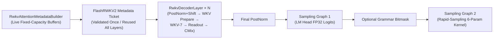

# Serving, State Management & Multi-GPU Deployment

This guide covers production serving with **irwkv**: recurrent state precision selection (FP16 default with DeltaLog budgeting vs FP32 parity), offline kernel dispatch and CUDA Graph warmup, prefix caching and multi-turn state continuation, multi-GPU PP2/DP scaling, and the optional Rust frontend.

---

## 1. Execution & State Pipeline Overview

In each scheduler step, `RwkvForCausalLM` binds one scheduler-visible `RwkvStateLayer` containing three per-slot tensors across all local decoder layers:

- **TMix shift state**: `[local_layers, slots, hidden_size]` (`bfloat16`)
- **CMix shift state**: `[local_layers, slots, hidden_size]` (`bfloat16`)
- **WKV recurrent state**: `[local_layers, slots, num_heads, 64, 64]` (`float32` or `float16`, bound through FlashRWKV2 state handles)



All stateful FlashRWKV2 kernels in a step share a single validated metadata ticket produced by `prepare_tmix_wkv7_recurrent_metadata`. When `num_active_tokens` / `num_active_sequences` are less than the captured graph capacity, TokenShift and WKV kernels skip padded rows on device without recompilation or host synchronization.

---

## 2. Choosing Recurrent State Precision (`float16` vs `float32`)

`irwkv` always uses **BF16** weights, token activations, and shift states, with **FP32** internal accumulation and **FP32** LM-head logits. Only the WKV recurrent state dtype is configurable via `--mamba-ssm-cache-dtype`:

| Mode | CLI Flag | WKV State Storage | Numerical Behavior | Recommended For |
| --- | --- | --- | --- | --- |
| **FP16 Serving (Default)** | `--mamba-ssm-cache-dtype float16` (or `auto`) | FP16 (`[H, 64, 64]`) + optional DeltaLog | Retains BF16 IO and FP32 math/logits, rounding WKV state to FP16 after every token (can change logits and sampled tokens vs FP32 training) | **General online serving** for lower state memory and higher concurrency |
| **FP32 Parity** | `--mamba-ssm-cache-dtype float32` | FP32 (`[H, 64, 64]`) | Matches the FP32 WKV recurrence used to recompute training logprobs across prefill and decode | **RL rollouts, evaluation, and sampling-parameter search** |

```bash
# Default FP16 serving state
irwkv serve /path/to/rwkv-checkpoint \
  --dtype bfloat16 \
  --enable-chunked-prefill \
  --no-enable-prefix-caching

# Explicit FP32 state (RL rollouts, evaluation, sampling search)
irwkv serve /path/to/rwkv-checkpoint \
  --dtype bfloat16 \
  --mamba-ssm-cache-dtype float32 \
  --enable-chunked-prefill \
  --no-enable-prefix-caching
```

In offline Python usage, pass `mamba_ssm_cache_dtype="float32"` to `LLM(...)` when exact training-recurrence parity is required.

### Deferred FP16 State (DeltaLog) & Memory Budgeting

For FP16 WKV state with `head_size=64` and `40` or `64` heads, FlashRWKV2 can defer writing the latest decode update to the bound FP16 tensor in a provider-managed DeltaLog:

- **Automatic budgeting**: At startup, the scheduler probes FlashRWKV2's `memory_layout` for one slot on the target device and adds `private_bytes_per_slot` per local layer to the page budget. The caller-backed pool holds BF16 shifts and the WKV base state. FP32 state and other geometries have zero private bytes.
- **State transfers & materialization**: Prefix-cache copies and resets route through the provider's state handles so pending FP16 updates follow the slot. For layouts with zero private bytes, copying snapshots one WKV layer at a time to preserve overlapping slot copies and bound temporary memory. Before reading or exporting the raw bound tensor directly, call `RwkvStateLayer.materialize_state_slots(slot_ids)` with contiguous CUDA `int32` slot indices.
- **Sampler preemption**: Sampler preemption stages per-request sampling state in host memory and restores it on the model execution stream.

---

## 3. CUDA Graph Capture and Kernel Preparation

### Default Compilation & Capture Behavior

RWKV defaults to `CompilationMode.NONE` and full CUDA Graph capture (`CUDAGraphMode.FULL`) so TorchDynamo does not decompose the external FlashRWKV2 fused operators. Use `--enforce-eager` only for diagnostics.

When `--cudagraph-capture-sizes` is not specified, `RwkvForCausalLMConfig` automatically selects capture sizes up to `min(max_cudagraph_capture_size, max_num_batched_tokens)` using the grid `1, 2, 4`, multiples of `8` up to `256`, multiples of `16` up to `1024`, and multiples of `1024` above `1024`.

In addition, `RwkvSampler` captures paired `(logits_graph, sample_graph)` CUDA Graphs at capacities `(1, 2, 4, 8, 16, 32, 64, 128, 256, 320, 512)` (plus `max_num_seqs` if not in that list). Requests that ask for logprobs, `min_p > 0`, logit bias, bad words, or thinking budgets fall back cleanly to the ungraphed `RwkvSampler.sample` path while keeping Rapid-Sampling semantics.

### Offline Kernel Dispatch & Native Build Cache

Starting with `FlashRWKV2 0.2.0a1`, FlashRWKV2 selects kernels directly from the **offline configurations** shipped with the provider — there is no online tuning phase:

- `irwkv` warms up the model and the head/sampling operations before CUDA Graph capture and passes active token/sequence counts during generation so padding leaves request state intact.
- `FLASHRWKV2_CACHE_DIR` continues to select the persistent cache root for FlashRWKV2 native builds (defaults to `~/.cache/flashrwkv2`). TileLang keeps its separate JIT cache at `~/.tilelang/cache`.
- **Migrating from earlier deployments**: Remove `IRWKV_RWKV_TUNING_MODE` and any standalone online-tuning preflight step. Launches with `--fail-on-environ-validation` reject the retired `IRWKV_RWKV_TUNING_MODE` variable.

---

## 4. Prefix Caching & Multi-Turn State Continuation

Prefix caching is disabled by default (`--no-enable-prefix-caching`), giving each request one private recurrent state slot (`mamba_cache_mode="none"`).

### Enabling Block-Aligned Prefix Sharing (COW)

Pass `--enable-prefix-caching` to switch RWKV to block-aligned cache mode (`mamba_cache_mode="align"`). `irwkv` hashes token prefixes at block boundaries and copies shared recurrent states via FlashRWKV2's copy-on-write (`copy_slots_`) before continuation so divergent suffixes never corrupt shared checkpoints.

For finer prefix reuse, set `--prefix-match-unit` to a divisor of the state block size:

```bash
irwkv serve /path/to/rwkv-checkpoint \
  --dtype bfloat16 \
  --enable-chunked-prefill \
  --enable-prefix-caching \
  --block-size 32 \
  --mamba-block-size 32 \
  --prefix-match-unit 8
```

With a 73-token repeated prompt under `--block-size 32 --prefix-match-unit 8`, a follow-up request can resume from token 72 instead of token 64. Note that `--prefix-match-unit` controls hashing granularity; only checkpoints actually saved by the scheduler can be reused.

### Multi-Turn Latest-Checkpoint Continuation

When prefix caching is enabled, each request retains its latest committed block-aligned state when it finishes, is aborted, or is preempted (a newer boundary of the same request replaces it):

- **Exact token-prefix match required**: Clients that resend the exact token history (such as `/v1/completions` or exact token continuation loops) resume from the retained boundary and compute only the remaining tokens.
- **Chat follow-ups**: Multi-turn `/v1/chat/completions` requests typically re-render history without the previous assistant generation prompt (or drop prior `<think>` blocks / re-serialize tool calls), so they diverge before the final turn boundary and automatically fall back to the last matching retained boundary.
- **Final sampled token**: The final sampled token of a turn is never fed back into the model, so it and any unaligned tail are recomputed on the next turn. Retained checkpoints live in the same evictable state pool and are recomputed transparently on eviction.

---

## 5. Multi-GPU Deployment (PP2 and DP)

RWKV does not use tensor parallelism (`--tensor-parallel-size` must remain `1`). Scale across GPUs with **Pipeline Parallelism (PP2)**, **Data Parallelism (DP)**, or both:

### Two-Stage Pipeline Parallelism (PP2)

Use PP2 for larger checkpoints (such as 13.3B on two 24 GB GPUs):

```bash
irwkv serve /path/to/rwkv-13.3b \
  --dtype bfloat16 \
  --pipeline-parallel-size 2 \
  --enable-chunked-prefill
```

- Stage 0 owns embedding, LN0, and the first half of decoder layers.
- Stage 1 owns the remaining decoder layers, final norm, and LM head.
- `hidden_states`, `residual`, and `v_first` are transferred between stages. Uneven layer splits across the two stages are supported.

### Data Parallelism (DP) and Hybrid DP + PP2

Combine `--data-parallel-size` with `--pipeline-parallel-size` to scale total concurrent slots across multiple GPUs (for example, 4× 24 GB GPUs as `DP4` for 1.5B–7.2B, or `DP2 + PP2` for 13.3B):

```bash
# 4 GPUs as DP4 (single-GPU replicas)
irwkv serve /path/to/rwkv-7.2b \
  --dtype bfloat16 \
  --data-parallel-size 4 \
  --enable-chunked-prefill

# 4 GPUs as DP2 + PP2 (two 2-GPU pipeline replicas)
irwkv serve /path/to/rwkv-13.3b \
  --dtype bfloat16 \
  --data-parallel-size 2 \
  --pipeline-parallel-size 2 \
  --enable-chunked-prefill
```

---

## 6. Optional Rust Frontend (`irwkv-rs`)

`irwkv` includes an optional Rust frontend (`irwkv-rs`, built on Axum + ZMQ/MessagePack) that moves HTTP/gRPC handling, chat template rendering, and incremental detokenization out of Python while communicating with the Python GPU engine core.

### Standard HTTP + gRPC Serving

```bash
IRWKV_USE_RUST_FRONTEND=1 irwkv serve /path/to/rwkv-checkpoint \
  --dtype bfloat16 \
  --enable-chunked-prefill \
  --host 127.0.0.1 \
  --port 8000 \
  --grpc-port 50051
```

- `--grpc-port` exposes `irwkv.Inference` and `irwkv.Control` gRPC services alongside HTTP (requires `IRWKV_USE_RUST_FRONTEND=1 irwkv serve` and cannot be combined with `--headless` or `--data-parallel-multi-port-external-lb`).
- Works with Python-supervised hybrid data parallelism.

### Standalone Frontend & Engine-Free Renderer

- **External engine mode**: Start headless Python engines (`irwkv serve ... --headless --data-parallel-address ... --data-parallel-rpc-port ...`) and attach `irwkv-rs serve ... --data-parallel-size-local 0`.
- **Engine-free render mode**: Run `irwkv-rs render <model>` to expose `/v1/chat/completions/render` and `/v1/completions/render` without PyTorch, weights, or GPUs.

See `rust/README.md` in the repository for standalone Cargo builds, TLS/mTLS flags, and full `irwkv-rs` usage.
